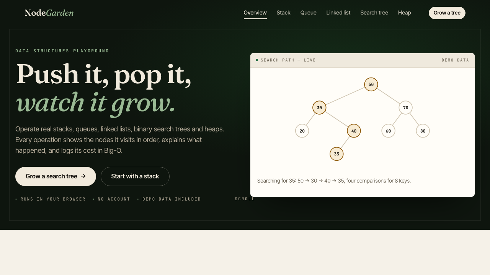
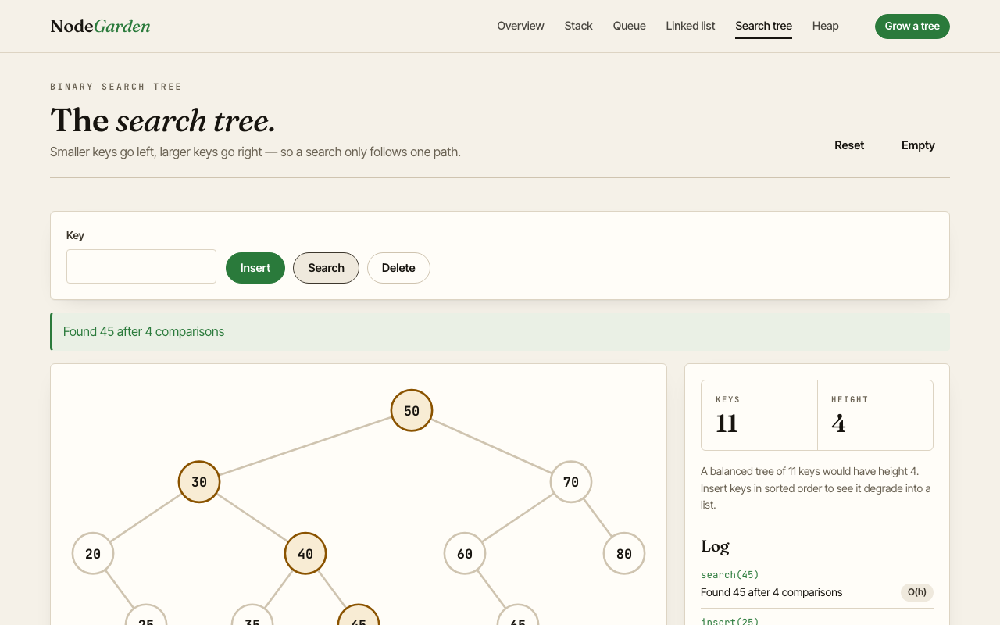
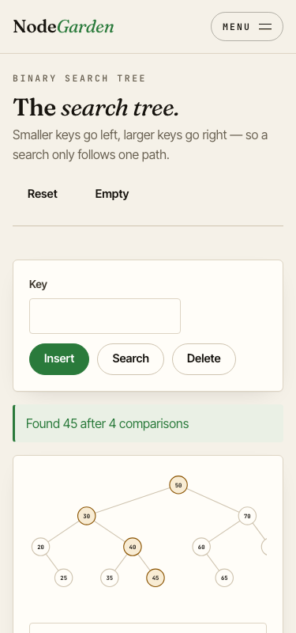

# Node Garden

A data-structures playground: operate a stack, a bounded queue, a singly linked list, a binary search tree and a min-heap. Every operation lights up the nodes it visits in order, explains what happened (including underflow, overflow and duplicates) and logs its Big-O cost.

**Live demo:** [https://node-garden.vercel.app/](https://node-garden.vercel.app/) — runs entirely in your browser.



| Search tree | Mobile |
| --- | --- |
|  |  |

## Run it

```bash
npm install
npm run dev        # http://localhost:5223
npm test
npm run build
npm run test:e2e   # Playwright smoke test (npm run e2e:install once if Chromium is missing)
```

## Main workflow

1. Each structure opens with sample values; **Reset** restores them (the search tree also has **Empty**).
2. **Stack** → push, pop, peek (top highlighted, underflow explained). **Queue** → enqueue and dequeue with an 8-slot capacity bar.
3. **Linked list** → insert at a position, append, find, remove and reverse; the walk from the head is highlighted step by step.
4. **Search tree** → insert, search and delete (leaf, one child, two children via the in-order successor); play in-, pre-, post- and level-order traversals; key count and height compared with a balanced tree.
5. **Heap** → insert (sift up) and extract-min (sift down), shown as both a tree and an array.
6. Every page keeps a log of the last 12 operations with their cost; all structures persist in this browser.

## Rules

- Values are whole numbers from −999 to 999. The BST ignores duplicates; the queue refuses items beyond capacity.
- Linked-list insertion at the head is O(1); anywhere else walks the list (O(n)).
- BST costs are O(h), where h is the tree’s height — log n when balanced, n when keys arrive in order.
- Heap children of index i are 2i+1 and 2i+2; insert and extract are O(log n).

## Design

Shared editorial system: Fraunces display type, Inter Tight interface text, mono values and costs, visited nodes highlighted in sequence with explanatory text, an ink hero showing a real search path, and a warm paper workspace. The step animations become instant under `prefers-reduced-motion`.

## Tests

- `src/lib/structures.test.ts` — stack and queue (underflow, capacity), linked-list insert/find/remove/reverse with traversal paths and costs, BST order, traversals, size, height, search paths, duplicates, all three deletes without mutating the original, layout, min-heap invariant through pushes and pops, sift paths, input parsing.
- `src/App.test.tsx` — stack with underflow and log, input validation, list find and remove, BST two-child delete and traversal, heap extract and insert.
- `e2e/smoke.spec.ts` — landing, BST insert/search with reload persistence and a level-order traversal, heap insert, list append, plus 375px layout checks.

## Limitations

- No self-balancing trees (AVL, red-black) yet.
- One instance of each structure.

## Future improvements

- AVL rotations visualised; a hash table with collision handling.

## Licence

MIT — see [LICENSE](LICENSE).
